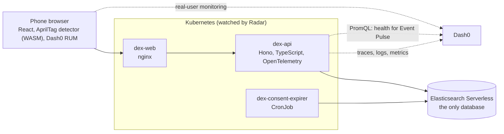

# Confer

**The front of your badge says hi. Only you say yes.**

Meeting someone at a conference shouldn't subscribe you to them. With Confer, a badge scan shows a first name, a silhouette and what you have in common. Your contact card and photo move only when you tap **Share**, and **Unshare** takes them back.

Built in one day at the Cloud Native Hackathon (WeMakeDevs, Salt Lake City, 2026-11-09).

## What it does

| Moment | What happens |
|---|---|
| **Meet** | Scan a badge (an AprilTag) from a metre away, several at once. You see a first name, a silhouette, and things in common, including *related* topics ("Tracing" and "OpenTelemetry"). The other person does nothing. The meeting lands in both people's list, which is also the "who scanned me" log. |
| **Share** | One-way and any time. The other person gets the fields you chose, and your silhouette fills in with your photo on their screen. **Unshare** removes it and writes a receipt. |
| **Booths** | A booth sees topics and fit, never a name. It can send a request with a note and an attachment. You get the attachment either way, and choose **Share**, **Ignore** or **Mute**. |
| **Discover** | "What are you stuck on?" finds the right talks, booths and people. |
| **Event Pulse** | Organizers see live numbers and booth share rates, with app health read live from Dash0. |

Why a sponsor wants this: a lead list of people who said yes (each with the note that won them), matching attendees who opted in but never walked past, content that reaches every scan, and share rate per pitch. More in [docs/design.md](docs/design.md).

Not built yet, and not shown as working: private forwarding email addresses, the evening digest, badge reissue.

## How it works



- **One contract.** [`apps/api/src/contract.ts`](apps/api/src/contract.ts) describes every route. The API returns values that `satisfies` it and the web app is typed by it.
- **The who-sees-what rule is one pure function** (`cardFor` in `apps/api/src/consent.ts`) with tests for every allowed and denied case.
- **The sealed envelope** (contact and photo) is its own index. It is read only for its owner or through an existing share, and every read writes a receipt that carries a trace id.
- **Things in common** are frozen at the first scan, and interest edits are capped, so nobody can probe someone else's interests by changing their own.

## For judges: where the evidence is

| Track | What to look at |
|---|---|
| **Elasticsearch** | It is the only datastore (`apps/api/src/es.ts`: profiles, vault, meetings, shares, requests, receipts, talks). Discover runs hybrid search (keyword + `semantic_text`, fused with RRF, reranked for free text) across talks, booths and people in one round trip; "related" things in common use embeddings; booth stats are aggregations. See [docs/evidence/search.md](docs/evidence/search.md). |
| **Dash0** | Traces, logs, metrics and RUM from API and browser; business spans (`scan`, `share`, `unshare`); receipts carry trace ids; Event Pulse reads health from Dash0 with PromQL; dashboard and SLO as code in `observability/`. Two real problems found and fixed with Dash0's AI tools: [docs/incidents.md](docs/incidents.md) (#2 missing logs via MCP, #4 slow saves via Agent0: 4.8s to 1.0s). See [docs/observability.md](docs/observability.md). |
| **Radar** | Runs on Kubernetes with Radar connected; its MCP server is used for every deploy (`issues`, `wait_for`), an AI investigation fixed the first broken deploy, and its audit took the namespace from 17 findings to 2. See [docs/radar.md](docs/radar.md). |
| **Sonar (Gitar)** | Every change landed through a pull request Gitar reviewed, starting with PR #1: see the [closed PRs](https://github.com/JoshTheMenace/confer/pulls?q=is%3Apr+is%3Aclosed). Review instructions in `.gitar/review/`, rules in `.gitar/rules/`. A CI failure diagnosed and fixed by Gitar: [docs/evidence/gitar-ci.md](docs/evidence/gitar-ci.md). |
| **Merge Forward** | Silhouettes mean nobody is judged on appearance before they choose to share. Approach and communication preferences, pronouns, scanning from a distance, a typed fallback for the camera, full keyboard use, reduced motion, and an accessibility gate in CI. See [docs/accessibility.md](docs/accessibility.md). |

The five-minute demo script is in [docs/demo.md](docs/demo.md).

## Run it

You need Node 24, pnpm 10, an Elasticsearch Serverless project (the Elasticsearch project type), and optionally a Dash0 organization.

```sh
cp .env.example .env            # fill in Elastic (and Dash0) values; set ES_INDEX_PREFIX=confer_ for a real event
pnpm install
pnpm --filter @dex/api demo:reset   # creates the indexes and seeds fictional people, booths and talks
pnpm dev                        # web on http://localhost:5173, API on http://localhost:3000
```

Open `http://localhost:5173/#/stage` for the presenter view. No backend at hand? `http://localhost:5173/?mock#/stage` runs the whole app on built-in sample data.

Demo sign-ins (seeded, fictional): `demo-500` Amara and `demo-501` Diego (attendees), `demo-580` Elastic booth, `demo-590` organizer.

### On Kubernetes (local kind cluster)

```sh
kind create cluster --name dex
docker build --target api -t dex-api:dev . && docker build --target web -t dex-web:dev .
kind load docker-image dex-api:dev dex-web:dev --name dex
kubectl apply -f k8s/base/namespace.yaml
kubectl -n dex create secret generic dex-secrets --from-env-file=.env
kubectl apply -k k8s/local
kubectl -n dex port-forward svc/dex-web 8080:80    # then open http://localhost:8080
radar                                              # Radar UI on http://localhost:9280
```

`k8s/base` is for a real cluster and pulls images from GHCR, which CI pushes on every merge to `main`.

### Checks

```sh
pnpm typecheck && pnpm lint && pnpm test && pnpm build
```

## AI disclosure

This project was built during the event with heavy AI assistance, directed by Josh Gimenes, who chose the problem, the product direction and the trade-offs, set up the accounts, and presented it.

- **Claude Code** (Anthropic: Claude Opus 5.5, then Claude Fable 5.2) wrote most of the code and documentation, working as a lead agent that planned the work and ran sub-agents in parallel.
- **GPT-6.1 Sol** (through Codex) advised on product, track compliance and design, and reviewed work.
- The web design was chosen by a competition: three Claude agents each built a full redesign, and a panel of **Grok 4.7**, **GPT-6.1 Sol** and **Claude Sonnet 5.5** judged them.
- **Gitar** reviewed every pull request and pushed some fixes itself. **Dash0 Agent0**, the **Dash0 MCP server** and **Radar's AI investigation** found the incidents in [docs/incidents.md](docs/incidents.md).

Every person, booth note, talk and portrait in the demo data is fictional. Portraits are generated illustrations ([DiceBear](https://www.dicebear.com), a CC0 style). The AprilTag detector is the BSD-licensed [apriltag-js-standalone](https://github.com/arenaxr/apriltag-js-standalone).
