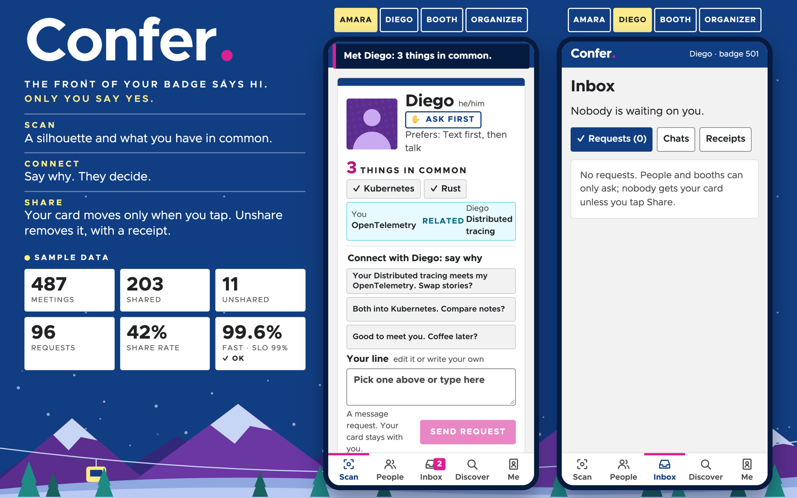
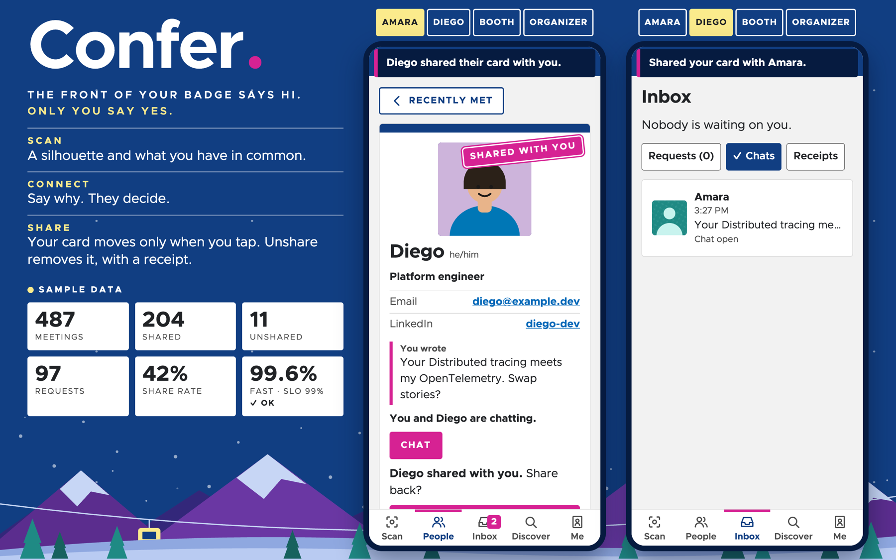
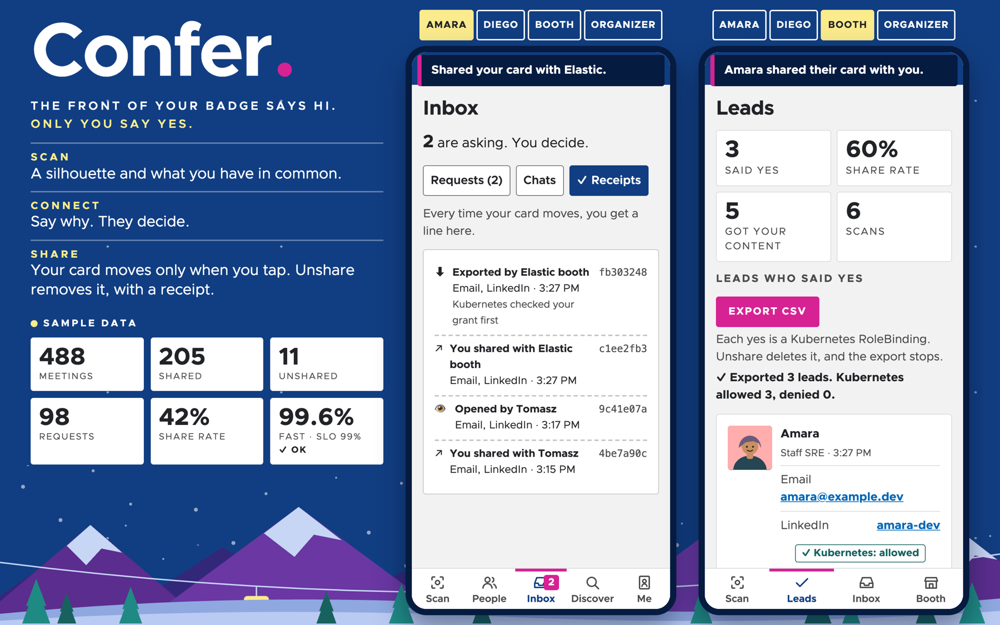
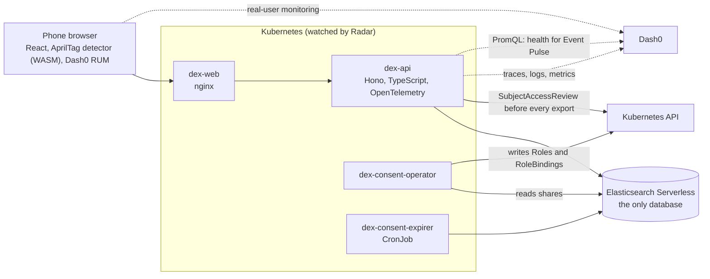

# Confer

**The front of your badge says hi. Only you say yes.**

People take a Sharpie to their own conference badges so booths can't scan them. One conference's badge guide even [told attendees how](https://us.wordcamp.org/2019/category/tickets/). A scan today can put your email on a lead list, and the sales emails start before you've flown home.

Meeting someone at a conference shouldn't subscribe you to them. With Confer, a badge scan shows a first name, a silhouette and what you have in common. To go further, someone has to **ask, and say why**. Your contact card and photo move only when you say so, and **Unshare** revokes them.

Built in one day at the Cloud Native Hackathon (WeMakeDevs, Salt Lake City, 2026-11-09).

## What it does

| Moment | What happens |
|---|---|
| **Meet** | Scan a badge (an AprilTag) with the camera, or type its number. You see a first name, a silhouette, and things in common, including *related* topics ("OpenTelemetry" and "Distributed tracing"). The other person does nothing. The meeting lands in both people's list, which is also the "who scanned me" log. |
| **Ask** | A **message request** says why you want to connect. The other person sees who is asking (a silhouette), the reason and what you have in common, then picks **Reply, Share my card, Ignore or Mute**. |
| **Chat** | Text chat inside every request. Chatting reveals nothing more than the card does. It is also the way to talk in a loud hall, or without speaking. |
| **Share** | One-way, any time. The other person gets the fields you ticked, and your silhouette fills in with your photo on their screen. **Unshare** removes it from Confer and writes a deletion receipt. It cannot recall a copy someone already made, and the app says so. |
| **Booths** | A booth sees topics and fit, and no name unless you allow it. It sends a request with a note and an attachment; the attachment is yours whether or not you share. The booth's lead list is only people who said yes, with the note that won them, and exports to CSV. |
| **Consent as Kubernetes RBAC** | Every yes to a booth is mirrored as a RoleBinding in that booth's own namespace. The CSV export asks Kubernetes about every row before it opens any contact data. Unshare deletes the binding, and the row leaves the export. See [docs/kubernetes-consent.md](docs/kubernetes-consent.md). |
| **Discover** | "What are you stuck on?" finds talks, booths and people who opted in to be found. |
| **Event Pulse** | Organizers see live numbers and each booth's share rate, with app health read live from Dash0. |



| Share: the photo appears because its owner chose it | Booth: leads who said yes, checked by Kubernetes before export |
|---|---|
|  |  |

Screenshots are from the presenter view on built-in sample data. A live sign-up on stage (the green square is a test camera): [stage-live-signup.png](docs/screenshots/stage-live-signup.png).

You can also set a rule in advance ("booths I starred get my card"). It is off unless you turn it on.

Why a sponsor wants this: a lead list of people who said yes (each with the note that worked), matching attendees who opted in but never walked past, and share rate per pitch. More in [docs/design.md](docs/design.md).

Not built yet, and not shown as working: private forwarding email addresses, the evening digest, badge reissue, and a claim code that proves you hold the badge whose number you type at sign-up.

## How it works



- **One contract.** [`apps/api/src/contract.ts`](apps/api/src/contract.ts) describes every route. The API returns values that `satisfies` it and the web app is typed by it, so a change breaks both builds instead of production.
- **The who-sees-what rule is one pure function** (`cardFor` in `apps/api/src/consent.ts`) with tests for the allowed and denied cases.
- **Contact and photo live in their own index** (`vault`). They are read only for their owner or through an existing share. Shares, unshares and exports each write a receipt with a trace id; card opens are recorded per viewer.
- **Things in common** are frozen at the first scan, and interest edits are capped, so nobody can probe someone else's interests by changing their own.
- **Elasticsearch is the system of record.** Kubernetes holds a copy of the booth grants and acts as a second lock on exports. If Kubernetes cannot be asked, the export says so in a response header instead of pretending.

Service, image and namespace names still say `dex`, the working title from the first hour. Renaming them late in the day was a risk with no benefit.

## For judges: the evidence, in numbers

Every number below was measured today on the running app, and every row links to the pull request that made it.

| Sponsor tool | What it found or proved | The number | Proof |
|---|---|---|---|
| **Dash0 Agent0** | Every request began by re-reading the sign-in from Elasticsearch: 707 of 720 requests, for only 4 distinct tokens. We cached it. | The three most-polled routes went from **p50 791 ms to 344 ms** and **p95 1,848 ms to 827 ms** (Dash0 spans, 25 minutes before against 8 minutes after). | [PR #20](https://github.com/JoshTheMenace/confer/pull/20), [Agent0's answer](docs/evidence/agent0-token-lookup.md), [incident 5](docs/incidents.md) |
| **Dash0 Agent0** | Every save waited on a search refresh. | Average save **4.78 s to 1.00 s** (first version of the API). | [PR #10](https://github.com/JoshTheMenace/confer/pull/10), [evidence](docs/evidence/agent0-latency.md) |
| **Dash0 tracing** | "Time to forget": Unshare is one traced span, from the tap to the card being gone. | **p95 0.83 s** over the afternoon. Every deletion receipt carries that trace id. | [docs/observability.md](docs/observability.md) |
| **Kubernetes RBAC** | `kubectl auth can-i export contacts.confer.dev/seed-502 --as booth:seed-580 -n booth-seed-580` before and after an attendee taps Unshare. | **yes, then no 3.9 s later.** The CSV export dropped the row on the very next request (2 rows to 1), because Elasticsearch answers first. Sharing again: yes after 7.8 s. | [PR #19](https://github.com/JoshTheMenace/confer/pull/19), [docs/kubernetes-consent.md](docs/kubernetes-consent.md) |
| **Radar AI investigation** | The first deploy: every pod stuck in `ErrImagePull`. Radar named the cause and the fix. | **All pods failing to 0.** | [PR #6](https://github.com/JoshTheMenace/confer/pull/6), [evidence](docs/evidence/radar-errimagepull.json) |
| **Radar audit (MCP)** | Hardening the namespace, then again after the consent operator was added. | **17 findings to 2**, then **7 to 5** (0 high; the 5 left are accepted, with reasons). | [PR #12](https://github.com/JoshTheMenace/confer/pull/12), [PR #22](https://github.com/JoshTheMenace/confer/pull/22), [docs/radar.md](docs/radar.md) |
| **Gitar** | Reviewed the API contract before any feature code existed and found that people search could be used to read what others wrote about themselves. Earlier it blocked a merge where sponsors could read interests attendees had hidden. | **22 pull requests reviewed, 27 inline findings**, and fixes pushed by Gitar itself on 14 of them, including one for a CI failure it diagnosed. We pushed back three times with evidence. | [PR #11](https://github.com/JoshTheMenace/confer/pull/11), [PR #4](https://github.com/JoshTheMenace/confer/pull/4), [PR #13](https://github.com/JoshTheMenace/confer/pull/13), [PR #21](https://github.com/JoshTheMenace/confer/pull/21), [evidence](docs/evidence/gitar-ci.md) |
| **Elasticsearch** | "Tracing across 200 services" returns the right talk first, plus matching booths and 6 people who opted in, from one round trip. Embedding similarity could not tell related topics apart, so a reranker judges them. | Cosine scored React and Rust (**0.51**) above OpenTelemetry and Distributed tracing (**0.49**); the reranker gets both right. The search answers in under a second. | [PR #14](https://github.com/JoshTheMenace/confer/pull/14), [PR #17](https://github.com/JoshTheMenace/confer/pull/17), [evidence](docs/evidence/search.md) |

## For judges: where each track lives in the code


| Track | What to look at |
|---|---|
| **Elasticsearch** | It is the only datastore (`apps/api/src/es.ts`: profiles, vault, tokens, badges, meetings, shares, threads, receipts, talks). Discover runs hybrid search (keyword + `semantic_text`, fused with RRF) over talks, booths and people in one round trip, and reranks talk results for typed questions. "Related" things in common are judged by an Elastic reranker. Booth and event stats are aggregations. See [docs/evidence/search.md](docs/evidence/search.md). |
| **Dash0** | Traces, logs, metrics and browser RUM; business spans (`scan`, `share`, `unshare`, `export`, `grants.reconcile`); receipts carry trace ids; Event Pulse reads health and an SLO from Dash0 with PromQL; dashboard, SLO and check rule as code in `observability/`. Three real problems found and fixed with Dash0's AI tools: [docs/incidents.md](docs/incidents.md) (#2 missing logs via the MCP server, #4 slow saves via Agent0, #5 a sign-in lookup on every request via Agent0). See [docs/observability.md](docs/observability.md). OpenLIT is initialized but idle: Confer makes no LLM calls today. |
| **Radar** | The app, the consent operator and the expiry job run on Kubernetes with Radar connected. Radar's MCP server checks each rollout (`wait_for`, `issues`), an AI investigation fixed the first broken deploy, and its audit drove the hardening of the namespace. Consent grants are visible in Radar as RoleBindings. See [docs/radar.md](docs/radar.md). |
| **Sonar (Gitar)** | Every pull request was reviewed by Gitar, starting with PR #1: see the [closed PRs](https://github.com/JoshTheMenace/confer/pulls?q=is%3Apr+is%3Aclosed). Review instructions in `.gitar/review/`, rules in `.gitar/rules/`. Gitar diagnosed a CI failure and pushed the fix, and pushed fixes of its own on other PRs; we pushed back three times with evidence. See [docs/evidence/gitar-ci.md](docs/evidence/gitar-ci.md). |
| **Merge Forward** | Photos stay hidden until the person shares. Approach and communication preferences, pronouns, text chat instead of talking, a typed fallback for the camera, reduced motion, and an accessibility gate in CI. What we tested and what we did not: [docs/accessibility.md](docs/accessibility.md). |

The five-minute demo script is in [docs/demo.md](docs/demo.md).

## Run it

You need Node 24, pnpm 10, an Elasticsearch Serverless project (the Elasticsearch project type), and optionally a Dash0 organization.

```sh
cp .env.example .env            # fill in Elastic (and Dash0) values; set ES_INDEX_PREFIX=confer_ for a real event
pnpm install
pnpm --filter @dex/api demo:reset   # creates the indexes and seeds fictional people, booths and talks
pnpm dev                        # web on http://localhost:5173, API on http://localhost:3000
```

Open `http://localhost:5173/#/stage` for the presenter view. No backend at hand? `http://localhost:5173/?mock#/stage` rehearses the screens on built-in sample data (no Kubernetes, no telemetry).

Demo sign-ins (seeded, fictional): `demo-500` Amara and `demo-501` Diego (attendees), `demo-580` Elastic booth, `demo-590` organizer. Badge 501 is left unclaimed, for a volunteer to claim at sign-up.

### On Kubernetes (local kind cluster)

```sh
kind create cluster --name dex
docker build --target api -t dex-api:dev . && docker build --target web -t dex-web:dev .
kind load docker-image dex-api:dev dex-web:dev --name dex
kubectl apply -f k8s/base/namespace.yaml
kubectl -n dex create secret generic dex-secrets --from-env-file=.env
kubectl apply -k k8s/local
kubectl -n dex port-forward svc/dex-web 8080:80    # then open http://localhost:8080
radar                                              # Radar UI on http://localhost:9280
```

`k8s/base` is for a real cluster and pulls images from GHCR, which CI pushes on every merge to `main`.

### Checks

```sh
pnpm typecheck && pnpm lint && pnpm test && pnpm build
```

## Observability

`pnpm obs:apply` pushes the dashboard, SLO and check rule in `observability/` to Dash0. What is instrumented, and how the app reads its own health back: [docs/observability.md](docs/observability.md).

## AI disclosure

This project was built during the event with heavy AI assistance, directed by Josh ([JoshTheMenace](https://github.com/JoshTheMenace)), who chose the problem, the product direction and the trade-offs, set up the accounts, drew the badge, tested the app and presented it.

- **Claude Code** (Anthropic: Claude Opus 5.5, then Claude Fable 5.2) wrote most of the code and documentation, working as a lead agent that planned the work and ran sub-agents in parallel.
- **GPT-6.1 Sol** (through Codex) advised on product, audited track compliance and reviewed work.
- The web design was chosen by a competition: three Claude agents each built a full redesign, and a panel of **Grok 4.7**, **GPT-6.1 Sol** and **Claude Sonnet 5.5** judged them. The final look was then restyled by another Claude agent.
- **Gitar** reviewed every pull request and pushed some fixes itself. **Dash0 Agent0**, the **Dash0 MCP server** and **Radar's AI investigation** found the incidents in [docs/incidents.md](docs/incidents.md).

Every person, booth note, talk and portrait in the seeded demo data is fictional. The booths are demo profiles named after the event's sponsors; their notes are invented. Portraits are generated illustrations ([DiceBear](https://www.dicebear.com), a CC0 style). The AprilTag detector is the BSD-licensed [apriltag-js-standalone](https://github.com/arenaxr/apriltag-js-standalone). The typeface is Clarity City (SIL Open Font License). The look is inspired by this week's conference; no conference or foundation logos or artwork are used.

## License

[MIT](LICENSE).
